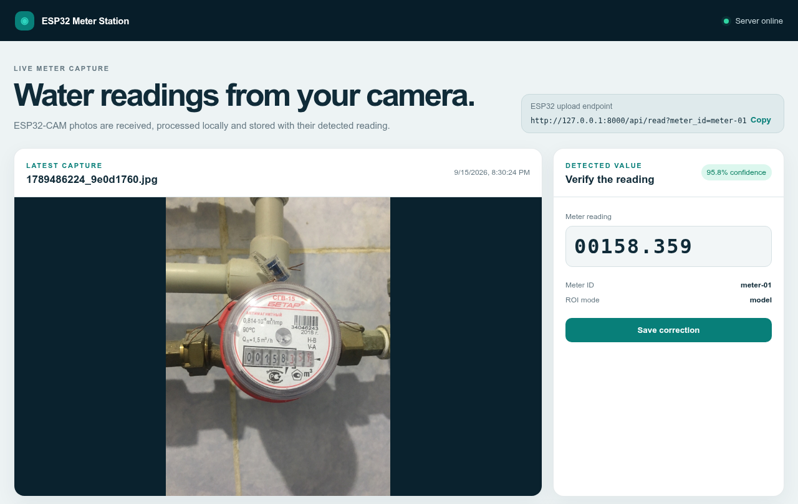
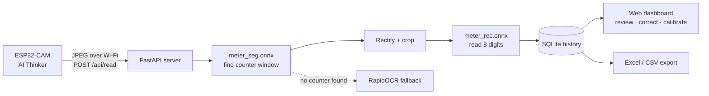
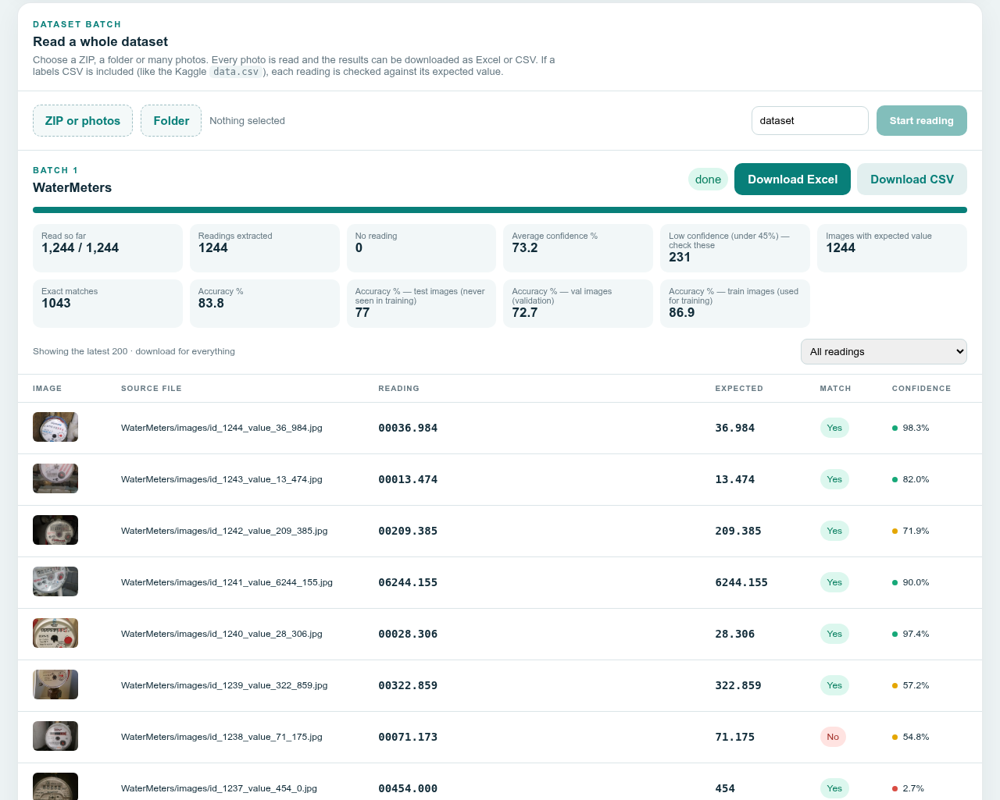

# ESP32-CAM Water Meter Reader

**Edge-to-desktop meter reading: an ESP32-CAM photographs a mechanical water meter, and a small two-stage vision model reads the 8-digit counter on an ordinary laptop CPU in about 0.1 s.**


<p align="center">
  
</p>

## Highlights

| Held-out test set (196 photos never seen in training) | |
|---|---|
| All 8 digits exactly right | **77.0 %** (151 / 196) |
| Whole cubic metres right (black digits) | **89.8 %** |
| Counter window found | **99.5 %** |
| Inference time | **~0.1 s / photo** on a laptop CPU, no GPU |
| General-purpose OCR baseline (RapidOCR), same photos | ~3 % exact, ~7 s / photo |

- **Two-stage model.** A segmentation network finds the counter window as a rotated box, using a whole-photo pass and then a zoomed pass. A recognition network then reads the straightened strip as 8 digits and detects upside-down crops. Together the two models are 4.6 MB of ONNX and run without PyTorch.
- **Calibrated confidence.** On unseen photos, readings at ≥ 75 % confidence were correct 97 % of the time, 45–75 % were correct 88 %, and readings under 45 % were correct only 27 %. The dashboard can filter for low-confidence readings so a human checks only those.
- **Honest evaluation.** Photos are split train/val/test with a deterministic hash of the file name. Every exported row is tagged with its split, so test accuracy and train accuracy are never mixed.
- **Complete system.** It includes the Arduino firmware, a FastAPI server with a browser dashboard, a batch CLI, Excel/CSV export, a retraining script and automated tests.

## System overview



<p align="center">
  
</p>

## Repository layout

| Path | Purpose |
|---|---|
| `esp32/esp32_cam_meter_sender.ino` | Arduino sketch: capture a JPEG every 30 s and POST it to the server |
| `app/` | FastAPI app, reading engine (`meter_model.py`, `reader.py`), dataset batching and the dashboard |
| `models/` | Trained ONNX models, accuracy report (`meter_model.json`) and the train/val/test split |
| `training/train_meter_models.py` | Retrains both models from images + masks + labels |
| `batch_read.py` | Command-line tool: dataset folder or ZIP → Excel + CSV |
| `tests/` | pytest suite for the reader, model, dataset parsing and batch API |
| `docs/` | Handover guide (PDF), screenshots and example result exports |

## Quick start

### Windows

1. Install 64-bit Python 3.11 or 3.12 from <https://www.python.org/downloads/> and tick **Add Python to PATH**.
2. Clone this repository.
3. Double-click `install_windows.bat` once. It needs internet access during installation.
4. Double-click `run_windows.bat` whenever you want to start the software.
5. If Windows asks about the firewall, allow access on **Private networks** so the ESP32 can connect.

### Linux

```bash
./run_linux.sh
```

The dashboard opens at <http://127.0.0.1:8000>. Use **Manual Test** to upload one photo, correct the result if needed, and save it.

### Run the tests

```bash
pip install -r requirements.txt pytest httpx
pytest -q
```

## Connecting the ESP32-CAM

1. Open `esp32/esp32_cam_meter_sender.ino` in the Arduino IDE. Install **ESP32 by Espressif Systems** and select **AI Thinker ESP32-CAM**.
2. Enter your Wi-Fi name and password.
3. Replace `192.168.1.100` in `SERVER_URL` with the server computer's IPv4 address (from `ipconfig`). Do not use `127.0.0.1` here.
4. Upload with GPIO 0 tied to GND, then remove the jumper and reset.

The PC and the ESP32 must be on the same network. Change `CAPTURE_INTERVAL_MS` to adjust the capture rate.

### Calibrating a fixed camera

Mount the camera so the counter is large, straight and evenly lit. In the dashboard, turn off **Auto** under *Fixed-Camera Calibration* and enter the reading-window position as percentages of the image. Set **Decimal places** to the number of red (fractional) wheels. For example, `3` turns `00123456` into `00123.456`.

## Reading a whole dataset

**Dashboard:** under *Read a whole dataset*, choose a ZIP, a folder or several photos and press **Start reading**. Progress, accuracy and readings update live. Download the results as Excel (a *Readings* sheet and a *Summary* sheet) or as CSV.

**Command line** (no server needed):

```bash
python batch_read.py ~/Downloads/water-meters-dataset/WaterMeters --subset test
```

Options: `--out`, `--name`, `--limit`, `--decimals`, `--labels labels.csv`, `--subset train|val|test`. If a labels CSV is present, or file names carry the value (e.g. `id_53_value_595_825.jpg`), each reading gets *Match* and *Difference* columns. Example exports are in [`docs/results/`](docs/results).

## API

| Method | Endpoint | Description |
|---|---|---|
| `POST` | `/api/read` | Raw JPEG body, header `X-Meter-ID`. Returns `reading`, `confidence`, `roi`, `image_url` |
| `POST` | `/api/batches` | Multipart `files`: images, ZIP and/or a labels CSV |
| `GET` | `/api/batches`, `/api/batches/{id}` | Batch list / status |
| `GET` | `/api/batches/{id}/readings?show=all\|mismatch\|empty` | Batch rows |
| `POST` / `DELETE` | `/api/batches/{id}/cancel`, `/api/batches/{id}` | Cancel / delete a batch |
| `GET` | `/api/export.xlsx`, `/api/export.csv` (`?batch_id=`) | Export live history or a batch |
| `GET` | `/health` | Health check |

## Dataset and retraining

The models were trained on the public [Water Meters dataset](https://www.kaggle.com/datasets/tapakah68/yandextoloka-water-meters-dataset) (1,244 photos with counter masks and readings; CC BY-NC-ND 4.0). The dataset is **not** redistributed here. Download it from the source.

```bash
python -m venv .trainenv
.trainenv/bin/pip install --index-url https://download.pytorch.org/whl/cpu torch
.trainenv/bin/pip install -r requirements-train.txt
.trainenv/bin/python training/train_meter_models.py ~/Downloads/water-meters-dataset/WaterMeters
```

Split: 75 % train / 10 % val / 15 % test, assigned by file-name hash. Training takes about an hour on a 6-core laptop CPU. `--stage seg` and `--stage rec` can run in parallel, followed by `--stage export`. Your own photos can use the same layout: `images/`, `masks/` and `data.csv` with `photo_name,value`.

## Limitations

- On training photos the model scores about 87 %, which is higher than its real accuracy. Only the **test** figure predicts performance on new photos.
- Other meter models and ESP32-CAM lighting conditions may score lower. For billing-grade use, collect a few hundred labelled photos from the target installation and retrain.

## Authors

Muhammad Adnan, Lab Engineer, SEECS, NUST, Islamabad, in collaboration with Ayaan Aatif.

## License

Code is released under the [MIT License](LICENSE). The Water Meters dataset is under its own CC BY-NC-ND 4.0 license and is not included.
